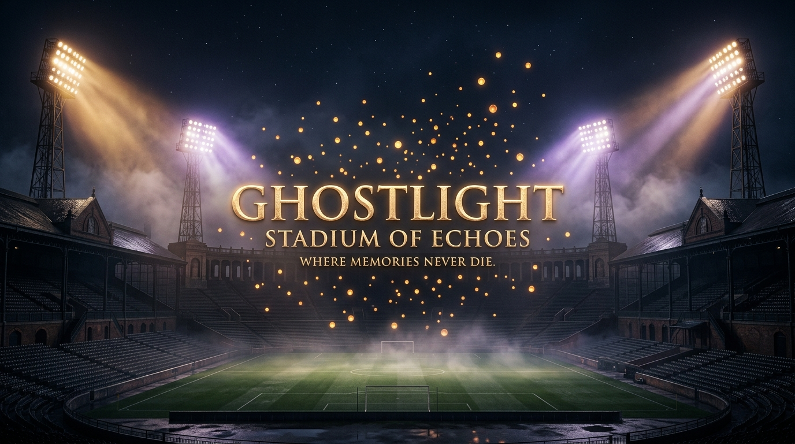

# GHOSTLIGHT: STADIUM OF ECHOES
> *“Where memories never die.”*
>
> **“Football remembers the scores. GHOSTLIGHT remembers the people.”**  
> *The final whistle is not the end of a memory.*

[](https://ghostlight-stadium-of-echoes.onrender.com)
[](LICENSE)
[](https://ollama.com/library/gemma3)



🔗 **Experience the Live Cloud Showcase:** [ghostlight-stadium-of-echoes.onrender.com](https://ghostlight-stadium-of-echoes.onrender.com)

An interactive digital museum and sensory installation where forgotten football memories come back to life through locally running open-weight artificial intelligence (**Google Gemma 3 4B** via **Ollama**).

The experience evokes entering an abandoned football stadium at midnight—hearing the cold wind through rusted turnstiles, watching floodlight towers gradually hum to life, and igniting individual beacons in the grandstands for each memory rescued from time.

---

## ✦ Core Features & User Journey

1. **The Entrance (Home — The Forgotten Stadium)**
   - Atmospheric midnight stadium aesthetics, dramatic volumetric floodlights, rolling mist, and floating ember particles.
   - Cinematic editorial typography with glowing calls to action.
   - One-click launcher for the official demo exhibit (*“Under the Lights”, October 1998*).

2. **Sanctuary Submission (Create Memory)**
   - Editorial memory submission with optional approximate year, club, and stadium.
   - Drag-and-drop artifact / photograph uploader with live thumbnail inspection.
   - Pre-fill button for instant demonstration.
   - Explicit local-first privacy notice.

3. **AI Séance — The Awakening**
   - Dramatic loading ceremony as stadium floodlight banks power on step-by-step.
   - Rotating meditative mantras:
     - *“Searching the echoes...”*
     - *“Connecting forgotten moments...”*
     - *“A memory is taking shape...”*
     - *“The stadium remembers...”*
   - Direct integration with local Ollama calling `gemma3:4b` in JSON mode.
   - Resilient diagnostics: if Ollama is offline or model is not downloaded, clear step-by-step terminal instructions are shown, alongside an option to awaken the memory using the local deterministic sanctuary engine.

4. **The Memory Reveal**
   - Grand illumination of an allocated seat coordinate in the grandstand (e.g. *North Stand • Sector 4 • Seat 42*).
   - Large gold title, evocative poetic narrative, and archival spotlight frame for photographs.
   - **Radical Separation of Truth**: Explicit two-column display distinguishing confirmed **Grounded Recollections** from **Lost Details**.
   - Memorable closing inscription (e.g. *“Some matches never end.”*).

5. **Ghost Narrator**
   - Built-in spoken-word narration using the browser’s `SpeechSynthesis` API, tuned to a calm, deep documentary cadence.
   - Real-time audio waveform visualizer.
   - Built-in Web Audio API synthesis creating an immersive ambient stadium night hum (55Hz sub-bass and filtered wind).
   - Extensible backend route `/api/narrate` ready for optional ElevenLabs neural voice keys.

6. **The Living Stadium**
   - Interactive architectural floorplan of the stadium pitch, penalty areas, center circle, and four distinct stands (*North Stand, South Stand Kop, West Grandstand, East Terrace*).
   - Every saved memory is represented as an illuminated, pulsing golden seat coordinate.
   - Hovering over a beacon reveals a floating preview card; clicking enters the full exhibit.
   - Live Sanctuary Luminosity meter (*% lit / total capacity*).
   - Stand filtering tabs.

7. **The Museum of Echoes (Local Archive)**
   - Curated gallery of all preserved exhibits stored locally in browser **IndexedDB** (no cloud databases, zero telemetry).
   - Filter by decade (*1970s, 1980s, 1990s, 2000s, 2010s+*) or search by club/keyword.
   - One-click **Archival Card Generation (PNG)**: Renders a 1200×1500px museum keepsake card with gold borders, stadium beams, typography, and stamps directly to the user's downloads folder.
   - Full JSON export and exhibit deletion with safety confirmation.

---

## ✦ Tech Stack

| Layer | Technologies |
|---|---|
| **Frontend** | React 19, TypeScript, Vite 8, Tailwind CSS v4, Framer Motion, Lucide Icons, Canvas Confetti |
| **Local Storage** | Browser IndexedDB (`idb`) for persistent offline memory & artifact image storage |
| **Audio** | Web SpeechSynthesis API (Ghost Narrator) + Web Audio API (Ambient stadium soundscape) |
| **Card Export** | HTML5 Canvas 2D Archival Renderer (PNG) + Structured JSON |
| **Backend** | Node.js, Express, TypeScript (`tsx`) |
| **AI Inference** | Ollama local API (`http://localhost:11434/api/chat`) running `gemma3:4b` |

---

## ✦ Ethical AI Principles

1. **Never Invent Historical Facts**: The AI prompt strictly prohibits inventing match scores, player goals, opposing clubs, or dates that the user did not specify.
2. **Strict Separation of Knowledge**: Extracted user details are separated into `known_facts` vs `unknowns` (missing details).
3. **No Impersonation**: Does not synthesize or simulate the voices or personal identities of deceased people.
4. **Honest System Attribution**: The UI never falsely claims AI processed a memory if it fell back to the deterministic local engine.

---

## ✦ Installation & Setup

### 1. Prerequisites
- **Node.js** v18+ (tested on Node v20+)
- **Ollama** installed locally ([ollama.com](https://ollama.com))

### 2. Download Recommended AI Model
In your terminal, pull the configurable Gemma 3 4B model:
```bash
ollama serve
ollama pull gemma3:4b
```
*(You can also use other models such as `gemma2:2b`, `llama3.2:3b`, or `mistral:7b` by updating `GEMMA_MODEL` in `.env`)*.

### 3. Clone & Install Dependencies
```bash
git clone <repo-url> ghostlight-stadium-of-echoes
cd ghostlight-stadium-of-echoes
npm install
```

### 4. Configure Environment
Copy `.env.example` to `.env`:
```bash
cp .env.example .env
```
Default configuration:
```env
PORT=3001
OLLAMA_HOST=http://localhost:11434
GEMMA_MODEL=gemma3:4b

# Optional ElevenLabs integration (defaults to Browser SpeechSynthesis)
ELEVENLABS_API_KEY=
ELEVENLABS_VOICE_ID=pNInz6obpgDQGcFmaJgB
```

---

## ✦ Running the Application

### Development Mode (Both Frontend & Backend)
```bash
npm run dev
```
- **Vite Frontend**: [http://localhost:5173](http://localhost:5173)
- **Express Backend**: [http://localhost:3001](http://localhost:3001)

### Production Mode
```bash
npm run build
npm run server
```
The entire application (frontend + API) will be served unified at [http://localhost:3001](http://localhost:3001).

---

## ✦ API Endpoints

- `GET /api/health`: Reports Ollama reachability, downloaded models, and ElevenLabs status.
- `GET /api/sample-memories`: Returns pre-packaged historical sample memories.
- `POST /api/analyze-memory`: Validates memory text, prompts Ollama `gemma3:4b` with strict JSON schema, or executes local deterministic extraction.
- `POST /api/narrate`: Optional ElevenLabs TTS proxy; defaults to browser SpeechSynthesis notice if key is omitted.

---

## ✦ Offline / Standby Experience

If Ollama is not installed or temporarily offline:
- The app will clearly alert the user with a diagnostic modal and terminal commands.
- The user can click **“Awaken With Local Engine”** to test the entire visual reveal, living stadium seat illumination, and archival card generation immediately without waiting.
- The pre-loaded demo exhibit (*“Under the Lights”, 1998*) can be explored immediately upon first opening.

---

## ✦ License
MIT © 2026 Ghostlight: Stadium of Echoes. Built for football romantics and timeless stories.
