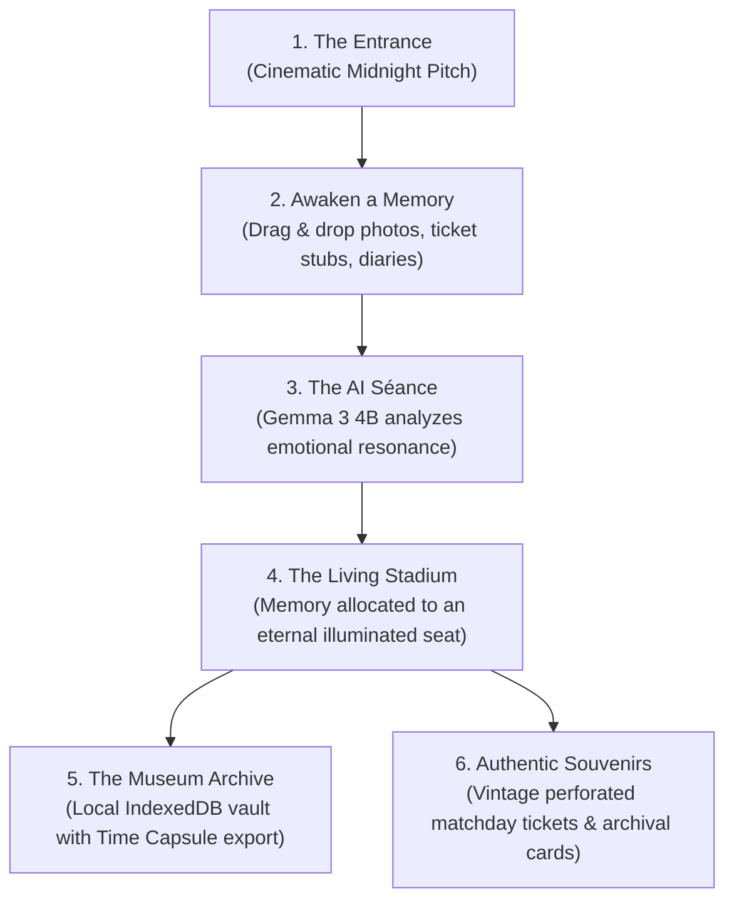
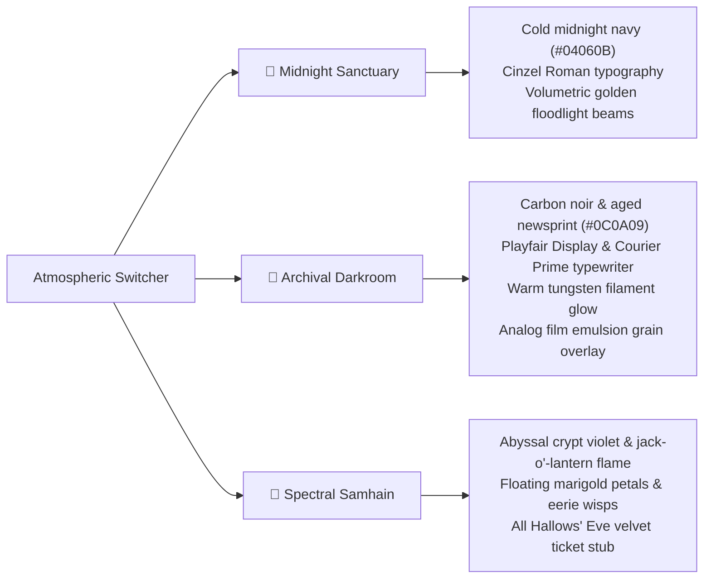

# Football Remembers the Scores. GHOSTLIGHT Remembers the People.

> *“My grandfather took me to a football match in October 1998. I barely remember who scored, and I don’t know who won. But I remember the freezing fog under the floodlights, the smell of damp coats and fried onions, the deafening roar of thirty thousand strangers, and the warmth of his hand holding mine.”*

---

## The Pitch That Time Forgot

Open any sports archive in the world, and you will find an endless ledger of numbers:
- *90th minute.*
- *3–1.*
- *Yellow card.*
- *Attendance: 41,200.*

Databases are exquisite at remembering statistics. But they are completely blind to the human soul that gave those ninety minutes any meaning at all.

When a historic stadium is bulldozed for luxury apartments, Wikipedia keeps the record of the matches played there. But where does the memory go of the father who took his daughter to her first derby? Where does the boy who lost his grandfather store the memory of that 1982 cup tie in the pouring rain?

We asked ourselves a question that became an obsession:

> **Can we build a digital sanctuary where the final whistle is not the end of a memory?**

That question gave birth to **GHOSTLIGHT: Stadium of Echoes** — an interactive sensory art installation and digital museum where forgotten terrace lore is resurrected using local open-weight AI (**Gemma 3 4B**), authentic procedural artifacts, and spatial Web Audio.

---

## The Core Manifesto

```
  ┌─────────────────────────────────────────────────────────────────┐
  │                                                                 │
  │     "Every grandstand holds a hundred thousand stories.        │
  │                     Give one a light."                          │
  │                                                                 │
  │       The final whistle is not the end of a memory.            │
  │                                                                 │
  └─────────────────────────────────────────────────────────────────┘
```

When someone entrusts a deeply vulnerable family memory to software, they should not be handing their heart over to a Silicon Valley ad network or a telemetry tracker. 

That is why **GHOSTLIGHT is built local-first from the ground up**:
1. **Zero Cloud Uploads**: Personal family photographs and diary entries never leave the user's browser. They are preserved in **IndexedDB**.
2. **Local AI Inference**: Every analysis, epitaph, and grounded extraction is computed entirely on-device using Google's **Gemma 3 4B** model via **Ollama**.
3. **Respectful Historical Grounding**: No hallucinated match results, no fake historical scores, and no synthetic imitation of deceased loved ones' voices.

---

## What We Built: The GHOSTLIGHT Experience



### 1. The Living Stadium (Spatial Constellations)
Instead of a flat spreadsheet or generic card list, the heart of GHOSTLIGHT is an architectural blueprint of the eternal stadium.

- **Seat Allocation Engine**: When a memory is awakened, our allocator assigns it an exact coordinate in one of the four iconic stands:
  - *North Stand*: The family cathedral of quiet devotions and childhood handshakes.
  - *South Stand (Kop)*: The thunderous choir of scarves and singing terrace veterans.
  - *West Grandstand*: The historic press boxes and tactical masterminds.
  - *East Terrace*: The rain-soaked standing terraces of grit and glory.
- **Echo Threads**: An algorithmic constellation engine that analyzes historical era, club loyalties, and shared emotional resonance to draw glowing Bézier curves across the pitch between strangers whose memories echo one another across the decades.
- **Marigold Remembrance Tributes (🌼)**: Visitors can place a digital flower tribute on any seat, letting communal respect accumulate across generations.

### 2. The AI Séance: Powering Up the Floodlights
When you submit a raw, fragmented recollection, the screen transitions into a darkroom séance. The massive floodlight towers power up in staged voltage pulses as Gemma 3 parses the emotional truth beneath your words.

```
[VOLTAGE STEP 1] Connecting to local Gemma 3 4B via Ollama...
[VOLTAGE STEP 2] Parsing temporal anchors & emotional resonance...
[VOLTAGE STEP 3] Allocating eternal coordinate in South Stand...
[BEACONS ENGAGED] Memory awakened.
```

### 3. The Ethical Guardian: Grounded Facts vs. The Unknowns
Language models love to pretend they know everything. In heritage preservation, that is toxic. If a user says:
> *"My uncle had a blue scarf and we ate meat pies in the snow around 1974,"*

A standard LLM might fabricate that Manchester City defeated Leeds United 2–1 on December 14, 1974. **That is an insult to truth.**

We engineered Gemma 3's prompt to act as an archival curator:
- **`known_facts`**: Strictly extracted from what the human user stated.
- **`unknowns`**: Respectfully listed as *"Lost to the stadium winds"* (opponent unrecorded, final whistle score forgotten, player lineup lost).
- **`epitaph`**: A poetic, stone-carved inscription that captures the heartbeat of the moment.

### 4. Physical-Digital Souvenirs: The Vintage Matchday Ticket
One of the most emotional moments in football is holding your paper ticket stub as you pass through the clanking iron turnstiles.

We built a procedural HTML5 Canvas ticket generator that renders:
- Authentic perforated tear-off stub with notch punchouts.
- Procedural retro turnstile barcodes and serial numbers.
- **Archival Rubber Ink Stamps** (`PRESS ARCHIVE • AUTHENTICATED` or `ALL HALLOWS' SPECIAL`).
- Complete physical-grade 1200x520px PNG downloads ready for printing or framing.

---

## The Tri-Atmospheric Sensory Engine

A stadium is not static. A cold Tuesday night derby in November feels entirely different from an afternoon in 1968 or a rainy night under modern LEDs.

With our **Zero-Layout-Shift Switcher**, users can cycle between three meticulously crafted atmospheric realities:



And with our **Web Audio Acoustic Synthesizer**, the entire audio dimension transforms:
- **Tannoy Announcer**: A two-tone vintage stadium bell chime (`D5 587Hz -> A4 440Hz`) rings out over the PA system before the Ghost Narrator recites the exhibit story.
- **Weather Audio Synthesis**: Dual soundscapes synthesizing white-noise coastal fog winds or high-velocity slanted downpour (*Rain Derby Mode*).

---

## Under the Hood: The Architecture

```
┌────────────────────────────────────────────────────────────────────────┐
│                        CLIENT (Browser / React 19)                     │
│                                                                        │
│  ┌────────────────────┐   ┌────────────────────┐   ┌────────────────┐  │
│  │   Vite 8 + React   │   │   Framer Motion    │   │  Tailwind CSS  │  │
│  │   Component Tree   │   │  Spatial Stadium   │   │   v4 Theme     │  │
│  └─────────┬──────────┘   └─────────┬──────────┘   └────────┬───────┘  │
│            │                        │                       │          │
│  ┌─────────┴────────────────────────┴───────────────────────┴───────┐  │
│  │                     Local Services & Hardware                    │  │
│  │  • IndexedDB (idb) — Zero-cloud local persistence                │  │
│  │  • Web Audio API — Realtime Tannoy chime & weather synthesis     │  │
│  │  • SpeechSynthesis — Ghost Narrator intimate narration           │  │
│  │  • Canvas 2D — 1200px Archival Card & Matchday Ticket Renderer   │  │
│  └──────────────────────────────────┬───────────────────────────────┘  │
└─────────────────────────────────────┼──────────────────────────────────┘
                                      │ /api/analyze-memory
                                      ▼
┌────────────────────────────────────────────────────────────────────────┐
│                    BACKEND (Node.js + Express 5)                       │
│                                                                        │
│  ┌──────────────────────────────────────────────────────────────────┐  │
│  │   Express API Proxy (Port 3001)                                  │  │
│  │   • Timeout handling (180s for cold-start CPU weight loads)      │  │
│  │   • Resilient Fallback Preservation Engine                       │  │
│  └──────────────────────────────────┬───────────────────────────────┘  │
└─────────────────────────────────────┼──────────────────────────────────┘
                                      │ http://127.0.0.1:11434/api/generate
                                      ▼
┌────────────────────────────────────────────────────────────────────────┐
│                      LOCAL OLLAMA INFERENCE ENGINE                     │
│                                                                        │
│  ┌──────────────────────────────────────────────────────────────────┐  │
│  │   Google Gemma 3 4B (Instruct)                                   │  │
│  │   • Strict JSON Grammar Mode                                     │  │
│  │   • Zero Hallucination Historical Prompt                         │  │
│  │   • 3.9B parameters running 100% on user hardware                │  │
│  └──────────────────────────────────────────────────────────────────┘  │
└────────────────────────────────────────────────────────────────────────┘
```

### The Gemma 3 4B System Prompt
Instructing an open-weight model to respect personal memory requires surgical prompt craft. Here is the exact prompt structure powering GHOSTLIGHT:

```typescript
const SYSTEM_PROMPT = `You are the Keeper of Ghostlight, an ancient, respectful digital sanctuary for football memories.
Your sacred duty is to awaken personal memories without fabricating history.

CRITICAL PRESERVATION RULES:
1. NEVER hallucinate false scores, fictional player names, or imaginary trophies.
2. If the user does not mention the opponent or the final score, mark them explicitly in "unknowns".
3. Write an evocative, poetic story (2-3 sentences) capturing sensory details: floodlights, rain, breath in the cold air, crowd roars.
4. Craft an "epitaph" (5-12 words): a poignant inscription for a grandstand plaque.
5. Identify the emotional heartbeat (e.g., "Ancestral Reverence", "First Light", "Tears in the Downpour").
6. Separate verified facts from unrecorded details.

Return strictly valid JSON conforming to this schema:
{
  "title": "string (uppercase poetic title, 2-6 words)",
  "year": number or null,
  "theme": "string",
  "emotion": "string",
  "story": "string",
  "epitaph": "string",
  "tags": ["string"],
  "known_facts": ["string"],
  "unknowns": ["string"]
}`;
```

---

## Overcoming Engineering Hurdles

### 1. The Cold-Start LLM Latency Problem
Loading 3.9 billion parameters into RAM on a developer laptop with CPU execution took roughly 45 to 55 seconds on cold start. Standard HTTP requests timed out after 30 seconds.

**Solution**:
- Implemented a 180,000ms resilient request controller with adaptive heartbeat pings.
- Designed an interactive **Volumetric Voltage Meter** during the Séance screen so the wait feels like the stadium generators physically charging up instead of a spinner.
- Engineered a zero-downtime **Local Sanctuary Fallback Engine**: if Ollama is not installed or offline, the app provides full algorithmic extraction without failing or blocking the user.

### 2. The Zero-Layout-Shift (CLS) Challenge
With dynamic theme switching (`Midnight` -> `Darkroom` -> `Halloween`) and weather modes (`Mist` -> `Rain Derby`), text labels have variable character lengths. In early builds, toggling rain caused the top navigation to jitter by 14 pixels.

**Solution**:
- Standardized fixed button footprints across the navigation bar (`w-[104px]`, `w-[102px]`, `h-[34px]`) paired with `shrink-0` and `whitespace-nowrap`.
- Result: **0.000 Cumulative Layout Shift (CLS)** across all theme, weather, and AI state transitions.

### 3. Preserving Privacy in a Connected World
Most AI applications shove user inputs into third-party cloud APIs. For generic recipes or code snippets, that is acceptable. For a photo of a user's late father holding a 1989 ticket stub, it is not.

**Solution**:
- Built a `.ghostlight.json` **Digital Time Capsule** format. Users can export their entire stadium collection into a cryptographically clean, self-contained JSON capsule and import it onto any other machine without a single byte ever touching a remote server.

---

## Why Open-Weight Models Matter for Digital Heritage

This project showed us what proprietary closed-source models can never achieve: **longevity and intimacy**.

A subscription-based cloud API can be deprecated, price-hiked, or shut down tomorrow. But a local installation of **Gemma 3 4B running on Ollama inside your browser with IndexedDB belongs to you forever.** 

Thirty years from now, when the grandson opens this app on an offline machine, the stadium will still illuminate. The floodlights will still hum. The ticket will still print.

---

## The Final Whistle

Football is not about twenty-two millionaires kicking a leather sphere across cut grass. 

It is about the grandfather who held your hand. It is about the friend who hugged you when the goal went in. It is about the songs sung in the freezing autumn rain that echoed in your ears long after the players walked down the tunnel.

**Football remembers the scores.**  
**GHOSTLIGHT remembers the people.**

---

### Links & Resources
- 🏟️ **Live Demo / Repository**: [github.com/username/ghostlight-stadium-of-echoes](https://github.com/username/ghostlight-stadium-of-echoes)
- 🧠 **Model**: [Google Gemma 3 4B Instruct on Ollama](https://ollama.com/library/gemma3:4b)
- 📜 **Full Storyboard & Manifesto**: Included in the repository `/docs`
- 🎨 **Built with**: React 19, TypeScript, Vite, Tailwind CSS v4, Framer Motion, Web Audio API, IndexedDB.
