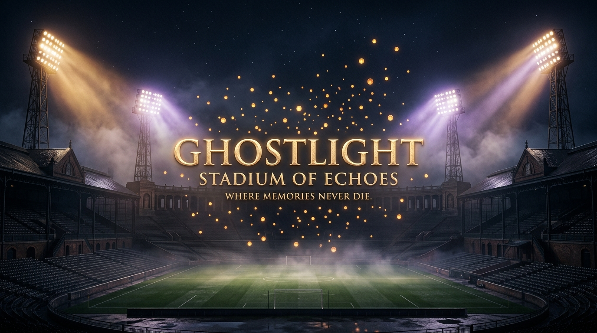

# GHOSTLIGHT: Stadium of Echoes
### *Football Remembers the Scores. We Remember the People.*

> **"Where memories never die."**

🏟️ **Live Showcase:** [https://ghostlight-stadium-of-echoes.onrender.com](https://ghostlight-stadium-of-echoes.onrender.com)  
📦 **Source Code (GitHub):** [https://github.com/budulay/ghostlight-stadium-of-echoes](https://github.com/budulay/ghostlight-stadium-of-echoes)

---

A football match lasts 90 minutes.  
Sometimes 120.  
**But a memory can last a lifetime.**

For some people, it's the roar of thousands of supporters. For others, it's the smell of wet grass, the glow of floodlights through the rain, an old ticket kept in a drawer, or the feeling of holding someone's hand while watching a match for the very first time.

Years pass. Stadiums are renovated or torn down. Tickets fade. Results become statistics in databases.

**But the memories remain.**

> *Football remembers the scores. GHOSTLIGHT remembers the people.*

That’s the idea behind **GHOSTLIGHT: Stadium of Echoes** — a cinematic, interactive digital sanctuary where forgotten football memories come back to life through locally running open-weight AI.

---


*Hero: The Forgotten Stadium under midnight floodlights.*

---

## The Idea: A Stadium Full of Memories

The theme of the **Hacktoberfest 2026 Ghost in the Machine** challenge inspired me to explore a different kind of digital ghost.

Not a ghost that scares people.  
**A ghost that preserves something worth remembering.**

I wanted to build an experience that connects football heritage, personal storytelling, open-weight artificial intelligence, and digital preservation.

The result is an interactive night stadium.

At first, it is almost completely dark. Its stands are silent. Only a few distant floodlights cut through the midnight mist.

Then someone leaves a memory.

An old matchday photograph. A ticket stub. A scarf. A few sentences about a football match experienced decades ago.

The AI helps transform that fragment into a living digital exhibit.  
A section of the grandstand illuminates.  
And the memory finds its eternal seat.

---

## How It Works

GHOSTLIGHT is designed around a three-step emotional loop:

$$\text{Leave an Artifact} \longrightarrow \text{Awaken a Memory} \longrightarrow \text{Explore its Echoes}$$

---

### 1. The Forgotten Stadium
The experience begins in an atmospheric football cathedral at night. The interface uses a midnight palette of near-black, deep navy, and warm luminous gold.

Volumetric floodlights, animated fog, drifting particles, and editorial typography create the feeling of entering a place suspended between the past and present.

The main invitation is simple:  
**SOME MEMORIES NEVER LEAVE.**

Users can awaken a new memory or explore the existing archive.

---

### 2. Leave an Artifact
Users can awaken a memory by entering:
- **A story or personal recollection**: A heartfelt paragraph of what they experienced.
- **An approximate year**: e.g., 1968, 1982, or 1998.
- **A football club or team**: The colors they cheered for.
- **A stadium**, if known: The cathedral where it occurred.
- **An optional photograph or visual artifact**: Uploaded via drag-and-drop.

The uploaded artifact becomes the centerpiece of the exhibit.

The system does not require users to know every historical detail. **An incomplete memory is still deeply worth preserving.**

---

### 3. The Ghost Awakens — Gemma Meets Ollama
This is where open-weight AI becomes the heartbeat of the experience.

GHOSTLIGHT uses **Google Gemma 3 4B**, running 100% locally through **Ollama**.

Instead of sending personal family stories to a remote commercial cloud, the client communicates with a local Express backend, which prompts the local model with strict archival guardrails.

The model transforms the submitted recollection into structured exhibit data:
- **Title**: An uppercase poetic exhibit name.
- **Approximate year**: Historical era anchoring.
- **Theme and emotional character**: e.g., *"Ancestral Reverence"*, *"First Floodlight Glow"*.
- **Narrative**: An evocative, respectful story capturing the sensory atmosphere.
- **Closing inscription**: A stone-carved epitaph for the grandstand plaque.
- **Tags**: Connecting historical motifs.
- **Grounded recollections**: Confirmed facts stated by the user.
- **Unknown or missing details**: Respectfully cataloged as *"Lost to the stadium winds"*.

> ### The Ethical AI Principle: Enrich, Never Rewrite History
> The system strictly distinguishes information explicitly provided by the user from details that remain unknown.
> 
> It **never invents** match results, fictional player lineups, attendance figures, or synthetic deceased voices simply to make a story sound complete.
> 
> A missing scoreline is not a bug to fix. It is part of what makes a human memory authentic.

---

### 4. The Memory Reveal
Once the memory has been processed during the floodlight power-up séance, the stadium begins to awaken:
- A newly allocated seat in the grandstand lights up.
- The exhibit title emerges in gold typography alongside the original uploaded artifact.
- Two distinct columns tell the story:
  - **Grounded Recollections**: Details verified by the person who submitted the memory.
  - **Lost to the Winds**: Information that remains forgotten in time.

The closing inscription might read:
> *“Some matches never end.”*

---

### 5. A Stadium That Speaks
I wanted the experience to engage the ears as deeply as the eyes.

GHOSTLIGHT includes two narration styles:
- **Tannoy**: An authentic stadium announcer voice, preceded by a synthesized two-tone stadium bell chime (`D5 587Hz -> A4 440Hz`).
- **Whisper**: A quieter, intimate museum-style narration.

The browser's native **SpeechSynthesis API** provides the voice. Meanwhile, a procedural **Web Audio API soundscape** adds a subtle stadium night hum, while the *Rain Derby* weather mode introduces synthesized rainfall and a stormy visual atmosphere.

Listening to a memory feels like attending a quiet private ceremony under the lights.

---

### 6. The Vintage Matchday Ticket


*Vintage Matchday Ticket: A physical-digital keepsake generated dynamically on HTML5 Canvas.*

One of the most distinctive details is the **Vintage Matchday Ticket generator**.

Every memory can become a high-resolution (1200x520px) digital keepsake:
- Authentic perforated edges with cutout notches.
- Archival exhibition title.
- Stand, sector, and seat coordinates.
- Period-inspired ink stamps (`PRESS ARCHIVE • AUTHENTICATED` or `ALL HALLOWS' SPECIAL`).
- Procedural retro turnstile barcodes and serial numbers.

Users can toggle between the **Museum Exhibit Plaque** and the **Vintage Matchday Ticket**, exporting either as a print-ready PNG image. It turns fleeting digital text into a tangible souvenir worth keeping.

---

### 7. The Living Stadium and Echo Threads


*Echo Threads: Luminous Bézier arcs connecting strangers through shared history.*

The stadium is more than a backdrop — it is a living entity.

Every saved memory occupies an illuminated coordinate in the stands:
- **North Stand**: Family devotions and childhood memories.
- **South Stand (Kop)**: Passionate chanting and terrace anthems.
- **West Grandstand**: Press boxes and tactical heritage.
- **East Terrace**: Historic standing terraces in the rain.

The **Echo Threads** feature takes this further: it automatically calculates and draws glowing Bézier curves between memories that share:
- The same decade (e.g., the 1970s or 1990s).
- The same football club.
- A common emotional resonance.

Someone who remembers a rainy cup match in 1989 is visually connected to someone else who cheered for the same club in that era. The stadium becomes an illuminated web of collective human belonging.

---

### 8. A Museum That Belongs to Its Owner
Digital preservation should never mean handing ownership of personal memories over to an ad-driven cloud platform.

GHOSTLIGHT follows an uncompromising **local-first approach**:
- All memories and high-res artifact images are stored directly in your browser's **IndexedDB**.
- The archive provides full-text search, decade filters, card downloads, and JSON metadata exports.
- **The Time Capsule**: Users can export their entire stadium collection into a self-contained `.ghostlight.json` file, and import it onto any other computer or browser.

The museum belongs entirely to the person who created it.

---

## Technology Behind the Experience

| Component | Technology |
|---|---|
| **Frontend** | React 19, TypeScript, Vite 8 |
| **Styling** | Tailwind CSS v4 (with zero-CLS theme variables) |
| **Animation** | Framer Motion (spatial canvas transitions) |
| **Backend Proxy** | Node.js, Express 5 |
| **AI Model** | Google Gemma 3 4B (Instruct) |
| **Local Runtime** | Ollama |
| **Persistence** | IndexedDB via `idb` |
| **Narration** | Native Browser `SpeechSynthesis` |
| **Acoustic Soundscape** | Web Audio API (realtime Tannoy chime + weather synthesis) |
| **Graphics & Artifacts**| HTML5 Canvas 2D image renderer |

### Architectural Flow:

```
  USER
    │
    ▼
  REACT 19 + VITE CLIENT
    │
    ├───► INDEXEDDB (Local Private Storage)
    │
    ▼
  EXPRESS 5 API (Port 3001)
    │
    ▼
  LOCAL OLLAMA ENGINE (Port 11434)
    │
    ▼
  GOOGLE GEMMA 3 4B (Strict JSON Mode)
    │
    ▼
  STRUCTURED MEMORY EXHIBIT
    │
    ▼
  MEMORY REVEAL (Seat Coordinates + Tannoy Audio + Vintage Ticket PNG)
```

The core AI workflow does not require a cloud LLM subscription or an API key. Everything runs on the hardware right in front of you.

---

## Why Open Innovation Matters

Running an open-weight model locally is not merely an engineering preference for GHOSTLIGHT. **It is a core product principle.**

Personal photographs, deceased relatives' tickets, and intimate family memories are sacred. They deserve far better protection than being sent to third-party cloud servers for training or surveillance.

Using **Gemma 3 through Ollama** gives GHOSTLIGHT five vital guarantees:
1. **Privacy & Control**: Memory text is processed on the user's machine without ever touching an external API.
2. **Independence**: The application will work twenty years from now, even if commercial AI APIs vanish or change their pricing models.
3. **Accessibility**: Anyone with consumer hardware can run the model locally.
4. **Ownership**: The archive and its `.ghostlight.json` Time Capsule remain strictly under the user's control.
5. **Reproducibility**: Any developer can clone the repository, pull `gemma3:4b`, and immediately experience the full installation.

---

## What I Learned

One of the biggest lessons from this project is that **AI applications do not always need to revolve around a conversational chatbot**.

Sometimes the most profound interface for an AI system is a **spatial experience**.

Gemma does not need to act like a sports statistician or guess match scores. Its role is far more human: helping people structure raw emotions, giving them an archival form, and preserving the sensory essence of a moment.

The small details are what bring the soul to life:
- The two-tone Tannoy chime before a story is spoken.
- The perforated tear-off line on a vintage matchday ticket.
- A single golden seat igniting in a darkened grandstand.
- A glowing thread connecting two strangers across fifty years of football history.

These details transform GHOSTLIGHT from another AI demo into an authentic **place of reverence**.

---

## What's Next?

GHOSTLIGHT began with football, but the underlying philosophy can expand into many cultural realms:
- **Supporter Club Heritage Archives**: Preserving historic community memory before legendary stadiums are renovated.
- **Family Legacy Museums**: Honoring passed generations and their shared passions.
- **Historical Places & Vanished Landmarks**: Reviving theaters, concert halls, and community centers.

The long-term ambition is to give communities the tools to preserve the human stories that official archives overlook.

---

## Try It Yourself

- **Project**: GHOSTLIGHT: Stadium of Echoes
- **Live Demo**: [https://ghostlight-stadium-of-echoes.onrender.com](https://ghostlight-stadium-of-echoes.onrender.com)
- **Source Code**: [https://github.com/budulay/ghostlight-stadium-of-echoes](https://github.com/budulay/ghostlight-stadium-of-echoes)
- **Cover Image**: [https://raw.githubusercontent.com/budulay/ghostlight-stadium-of-echoes/main/public/cover.png](https://raw.githubusercontent.com/budulay/ghostlight-stadium-of-echoes/main/public/cover.png)

### Running Locally:

1. Install Ollama and download the model:
```bash
ollama serve
ollama pull gemma3:4b
```

2. Clone and start the application:
```bash
git clone https://github.com/budulay/ghostlight-stadium-of-echoes.git
cd ghostlight-stadium-of-echoes
npm install
npm run dev
```

3. Open in your browser:
```
http://localhost:5173
```

The sample memory can also be explored instantly without live AI inference. For real-time memory analysis, ensure Ollama is running with `gemma3:4b`.

---

## The Final Whistle

I started with a simple question:  
*What if we could preserve the feeling of a football match, not just its score?*

A stadium is far more than concrete, grass, and plastic seats.

It is a place where generations meet. Where friendships begin. Where families forge traditions. Where complete strangers hug in the pouring rain when a goal crosses the line in the 93rd minute.

And perhaps somewhere, in an old drawer, there is still a faded ticket from a match that nobody else remembers.

**That ticket deserves a place.**  
**That story deserves a light.**

> *Football remembers the scores.*  
> *GHOSTLIGHT remembers the people.*  
> 
> *The final whistle is not the end of a memory.*

---

🏟️ **GHOSTLIGHT: Stadium of Echoes** — *Where memories never die.*

---

### Tags:
`#ai` `#hacktoberfest` `#hf26challenge` `#devchallenge` `#gemma` `#ollama` `#opensource` `#webdev`
